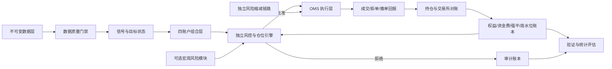

# BTC/ETH 多空量化研究与验证系统设计

- 文档版本：v1.0
- 文档状态：三方有条件确认后的系统设计基线
- 日期：2026-11-23
- 系统定位：研究、回测、纸面交易与前瞻验证优先
- 参与视角：经济学家、数学家/统计学家、交易员、系统工程师
- 重要边界：本文不承诺收益，不授权自动扩仓或直接接入空头实盘

## 1. 背景

当前研究包含两条性质不同的路线：

1. 分钟级订单流与五分钟吃单策略，在手续费、滑点、等待和排队实验后仍未形成可覆盖成本的优势。本设计不恢复该版本，也不允许通过加仓或提高交易次数挽救负期望。
2. BTC/ETH 低频周轮动存在历史点估计正收益，但历史数据已多次用于规则研究，不能继续作为独立样本外证明。现有冻结前瞻配置必须完整保留。

用户希望研究经济下行环境下的多空方案，并在可承受回撤内逐步调整仓位。三方评审形成的共同方向是：采用多状态研究与独立验证，而非立即双向开仓；宏观只用于低频风险约束；仓位由不确定的回撤分布、流动性和保证金共同约束。

## 2. 输入资料与现状约束

本设计依据以下已有材料：

- `weekly_profit_cycle.py`：历史周轮动收益与回撤评估。
- `weekly_profit_cycle_results.json`：两交易所、多窗口和两档成本的历史结果。
- `weekly_profit_forward.py`：冻结窗口的纸面回放与验收逻辑。
- `weekly_profit_forward_version.json`：冻结日期、成本、仓位、数据路径和代码哈希登记。
- 高频订单流实验 01—03：负净期望、执行等待及被动排队实验记录。
- 小资金现货策略研究记录：低频候选、执行限制及历史研究过程。

现有冻结配置的关键约束：

| 项目 | 当前值 | 本设计处理方式 |
|---|---|---|
| 前瞻开始日 | 2026-11-21 UTC | 不修改 |
| 初始权益 | 100 USDT | 不修改 |
| 目标名义仓位 | 12.25 USDT | 不修改 |
| 原回撤门槛 | 8% | 不修改 |
| 基准与压力成本 | 已登记 | 不修改 |
| 数据与代码哈希 | 已登记 | 不覆盖、不复用为新版本证明 |

新研究配置与原冻结配置必须使用不同命名空间、结果目录和版本号。

## 3. 系统目标与非目标

### 3.1 系统目标

1. 建立可复现、可审计、默认安全的低频多空研究系统。
2. 在相同时间轴、成本口径和事前风险预算下比较四类账户。
3. 防止前视偏差、重复消费测试集、冻结后调参和审计记录覆盖。
4. 统一模拟手续费、滑点、资金费、合约规格、数量取整、保证金和强平。
5. 将策略信号、风险批准、订单执行和实际持仓严格解耦。
6. 在数据不足时拒绝扩仓，而不是输出伪精确的仓位倍率。
7. 为纸面交易和未来可能的实盘接入保留同一套执行与对账接口。

### 3.2 非目标

- 不承诺收益或保证最大回撤不被穿越。
- 不将宏观预测直接转化为分钟级买卖信号。
- 不在本轮恢复高频吃单策略。
- 不在本轮上线 BTC/ETH 双腿相对价值实盘。
- 不在样本外证据不足时增加杠杆或仓位。
- 不修改、覆盖或“优化”既有冻结前瞻版本。

## 4. 三方需求确认结果

三方均为“有条件确认”。以下条件已纳入本文正文：

| 视角 | 核心确认条件 |
|---|---|
| 经济学家 | 宏观只输出风险档位；条件空头必须优于仅空仓；压力测试包含政策急转、逼空、资金费反转和平台故障 |
| 数学家 | 测试集一次性消费；四账户采用配对比较；仓位通过候选倍率重模拟和回撤上界确定；样本不足新增倍率为零 |
| 交易员 | 增加在途状态；故障时仅禁止新增风险而保留减仓链路；状态以成交回报为准；恢复必须人工复核和持仓对账 |
| 系统工程师 | 模块边界、接口、审计、确定性和验收测试必须可实现、可追踪 |

## 5. 已确认需求决策表

| ID | 决策 |
|---|---|
| D01 | 原冻结版本及其 8% 门槛保持不变；任何影响信号、成本、数据或仓位的改动均创建新版本并重置前瞻 |
| D02 | 20% 是风险处置线，10%—12%是内部预算范围；均不构成不越界保证，实施前必须选定唯一内部预算 |
| D03 | 四账户 B/L/S/C 同轴、同风险预算；主检验为 C-B，次要比较进行多重检验校正 |
| D04 | 空头模型必须包含资金费、滑点、合约规格、保证金、强平和逼空 |
| D05 | 宏观首版可关闭；启用后仅输出正常、降档、禁止新增风险三档 |
| D06 | 状态包括 LONG、FLAT、SHORT、TRANSITIONING；禁止直接翻仓和在途订单叠加 |
| D07 | 故障时禁止新增风险，但减仓、平仓、撤单和强平监控链路保持可用 |
| D08 | 决策、下单和成交时间分离；吃单按对手价和深度；资金费按实际持仓，强平使用标记价 |
| D09 | 封存测试集只消费一次；序贯查看须预登记统计支出，否则等待全新数据 |
| D10 | 候选仓位倍率必须重模拟复利、费用和强平；样本不足新增倍率为零 |
| D11 | 恢复须人工复核、健康检查和持仓对账，从 FLAT 开始，历史高水位不得重置 |
| D12 | 相对价值仅纸面备选；高频新机制独立验证，不继承低频仓位 |
| D13 | 旧历史用于开发与压力测试；近期及冻结后数据用于主评分；固定周数、笔数或历史回撤均不能单独放行 |
| D14 | 小账户固定数值政策须由用户单独批准，不得写成普适统计结论 |

## 6. 总体架构



### 6.1 架构原则

- **不可变输入**：原始数据、配置、代码和冻结结果均保留哈希。
- **单向决策链**：信号不得绕过风控直接生成订单。
- **实际状态优先**：账户状态来自成交和持仓对账，不来自下单意图。
- **风险缩减独立**：数据或连接故障不得阻塞平仓、撤单和强平监控。
- **研究、纸面、实盘共用核心模块**：仅执行适配器不同，禁止三套成本逻辑。
- **默认拒绝**：配置缺失、数据无效、规则未知或校验失败时禁止新增风险。

## 7. 模块设计

### 7.1 不可变数据层

负责原始行情和规则数据的采集、保存、版本化与质量标记，不负责策略判断。

必需数据域：

| 数据域 | 关键内容 |
|---|---|
| K 线/成交 | 交易所时间、接收时间、可得时间、价格、数量、序列号 |
| 盘口 | 买卖价量、深度、序号连续性、快照与增量关系 |
| 资金费 | 实际结算时间、结算费率、适用持仓、标记价 |
| 标记/指数价格 | 用于强平和保证金计算，不得用最新成交价替代 |
| 合约规则 | 数量步长、最低名义金额、合约乘数、保证金档位、生效时间 |
| 数据质量 | 缺口、时钟跳变、陈旧、断连、重建状态、拒绝原因 |
| 宏观数据（可选） | 初次发布值、发布时间、可得时间、修订版本和来源 |

禁止行为：静默填补缺口、使用后修订宏观值、将未来合约规则应用于过去、跨断档推定盘口连续。

### 7.2 数据质量门禁

输出 `DataHealth`，至少包含：

- `is_open_allowed`：是否允许新增仓位；
- `is_mark_allowed`：权益和强平标记是否可信；
- `stale_seconds`：数据陈旧程度；
- `sequence_gap`：是否存在序列断档；
- `clock_jump`：是否发生时钟异常；
- `reason_codes`：机器可读原因。

数据无效时禁止新增仓位；是否允许平仓由独立风险缩减链路和健康状态决定。

### 7.3 信号模块

输入已完成且当时可得的数据，输出目标状态和目标风险敞口，不直接下单。

```text
SignalResult:
  strategy_version
  decision_time
  target_state: LONG | FLAT | SHORT
  target_risk_fraction
  reference_price
  reason_codes
  input_watermark
```

约束：

- 信号只能引用 `available_time <= decision_time` 的数据。
- K 线策略只能使用已完成 K 线。
- 宏观模块不得直接生成 `SHORT`。
- 在途期间的新信号默认作废；如未来改为最多排队一个，必须单独冻结配置。

### 7.4 四账户组合层

| 账户 | 含义 | 作用 |
|---|---|---|
| B | 原策略基准 | 主比较基准 |
| L | 纯多/空仓 | 判断多头与空仓机制本身的价值 |
| S | 纯空/空仓 | 独立检验空侧净期望与尾部 |
| C | 冻结规则的多空组合 | 主检验对象 |

要求：

- 使用相同时间轴和事前风险预算。
- 各自遵守真实合约规则，不为比较而假设小账户可执行不存在的订单。
- C 的权重和状态规则必须在测试前冻结。
- 相对价值另建纸面研究账户，不与 C 混合申报结果。

### 7.5 成本与合约模块

统一负责：

- 手续费和实际费率档位；
- 对手价、深度冲击和部分成交；
- 数量向下取整、最低下单和合约乘数；
- 资金费逐次结算；
- 保证金、标记价强平和强平费用；
- 滑点、资金费和取整损耗的实测回填。

回测、纸面和实盘必须可逐项对账。任何成本参数更新均生成新版本。

### 7.6 独立风控与仓位引擎

风控输出批准、减仓、禁止新增风险或停机决定。信号强度不得覆盖风控上限。

仓位约束：

```text
approved_notional = min(
    strategy_request,
    drawdown_limit,
    liquidity_limit,
    margin_limit,
    instrument_limit
)
```

详细倍率算法见第 12 节。

### 7.7 OMS 执行层

负责订单生命周期：创建、批准、提交、部分成交、成交、拒单、撤单和超时。

最低要求：

- 决策、下单、成交使用不同时间戳；
- 部分成交按实际数量更新仓位；
- 在途订单未终结前禁止叠加反向或重复订单；
- 撤单确认前不得认定进入 FLAT；
- 记录信号参考价、成交均价和逐笔滑点；
- 减仓/平仓订单使用独立高优先级通道。

### 7.8 账本与对账模块

账本至少记录：

- 已实现与未实现盈亏；
- 手续费、资金费和强平费用；
- 可清算权益与历史高水位；
- 总敞口、净敞口和保证金占用；
- 在途订单、实际净仓和交易所持仓；
- 回撤、降档、停机和恢复事件。

服务重启不得清零历史高水位或回撤状态。

### 7.9 验证与审计模块

保存数据、代码、配置、统计方案和结果的哈希；记录测试集消费状态和序贯查看支出。

冻结结果只能追加审计注释，不得覆盖原结果。任何实质改动均生成新策略版本和新前瞻起点。

## 8. 状态机设计

### 8.1 状态定义

| 状态 | 定义 |
|---|---|
| LONG | 实际净仓为多，且无未终结订单 |
| SHORT | 实际净仓为空，且无未终结订单 |
| FLAT | 无持仓且无未终结订单 |
| TRANSITIONING | 存在未终结订单，或本地状态尚未完成交易所对账 |

### 8.2 合法转换

```text
LONG -> TRANSITIONING -> FLAT
FLAT -> TRANSITIONING -> LONG
SHORT -> TRANSITIONING -> FLAT
FLAT -> TRANSITIONING -> SHORT
LONG -> TRANSITIONING -> FLAT -> TRANSITIONING -> SHORT
SHORT -> TRANSITIONING -> FLAT -> TRANSITIONING -> LONG
```

禁止 `LONG -> SHORT` 或 `SHORT -> LONG` 的直接目标转换。

### 8.3 在途与异常规则

- 在途期间新信号默认作废，不叠加订单。
- 部分成交后按实际净仓重算，不假定最终全部成交。
- 订单全部终结且持仓对账完成后才能进入稳定态。
- 风险停机后从 FLAT 恢复，不自动重建原仓位。
- 强平发生即风控失败，禁止自动补回仓位。

## 9. 事件时序与成交模型

标准时序：

```text
数据完成 ->指着 决策时间 -> 风控批准 -> 下单时间 -> 首个可成交时点 -> 成交回报 -> 持仓对账
```

最低验收要求：

1. 禁止“收盘价生成信号并按同一收盘价成交”。
2. 延迟必须进入成交价格和成本。
3. 吃单按对手价和可见深度计算，不使用中间价。
4. 部分成交、拒单、撤单和订单超时必须可重放。
5. 资金费按实际持仓经过的结算时点计算。
6. 强平使用标记价格和当时有效的保证金规则。
7. 数量取整后低于最低下单要求时拒绝并记录。

## 10. 统计验证设计

### 10.1 数据分区

按时间划分：

1. 开发集；
2. 验证集；
3. 一次性封存测试集；
4. 后续前瞻集。

要求：

- 边界按最长持有期清除标签重叠，并设置隔离期。
- 所有时间按当时可得性判定。
- 主指标、比较对象、显著性水平、区块规则、有效样本量和停止日期在揭盲前登记。
- 封存测试集只能消费一次；失败后不得改名继续调参并重复报告原测试。
- 如需序贯查看，必须预登记统计支出；否则等待全新数据。

### 10.2 四账户比较

- 主检验：`C - B` 的配对增量。
- 次要比较：`L - B`、`S - FLAT`、`C - L` 等，须校正多重检验。
- 使用相同重抽样索引，保留时间依赖和交易簇。
- 同时报告净收益、回撤、换手、资金费、联合尾部和不可执行比例。
- 空头本身可为负收益，但必须证明减尾价值大于收益损耗，且组合满足全部风险约束。

### 10.3 晋级解释

- 区间跨零：证据不足，不等于已证明策略无效，但不得扩仓。
- 30 天、12 周、100 笔：只能作为观察进度，不单独构成统计通过。
- 统计通过也不等于收益或回撤保证。
- 每次查看结果均须留痕，防止反复窥视。

## 11. 宏观风险模块（可选）

首版默认关闭。启用后仅输出：

| 档位 | 系统动作 |
|---|---|
| NORMAL | 不额外限制，但仍受其他风控约束 |
| DE_RISK | 禁止升档或降低新增风险上限 |
| NO_NEW_RISK | 禁止新增仓位，保留风险缩减链路 |

要求：指标少、更新频率低、规则冻结、使用当时发布版本；缺失或延迟时记录失效状态，不生成连续衰退概率，不直接触发 SHORT。

## 12. 仓位与回撤设计

### 12.1 回撤口径

使用可清算权益，包括未实现盈亏、手续费、资金费和强平影响：

```text
drawdown = 1 - liquidatable_equity / historical_high_watermark
```

历史高水位跨重启保留。20% 和内部预算是风险处置线，不是收益目标，也无法保证跳空时不被穿越。

### 12.2 候选倍率评估

对每个候选倍率 `k` 直接重模拟：

- 复利和实际权益；
- 手续费、滑点、资金费；
- 数量取整和最低下单；
- 保证金与强平；
- 流动性和参与率；
- 跳空及联合压力情景。

令 `U_k(H)` 为未来期限 `H` 内最大回撤分布的预登记上分位及其单侧置信上界，则：

```text
k* = min(
    k_liquidity,
    k_margin,
    sup{k: U_k(H) <= internal_drawdown_budget}
)
```

仅在明确验证的线性区域才允许近似，不采用 `20% / 历史最大回撤` 作为安全倍率。

### 12.3 样本不足与升档

- 样本不足或上界不可估：新增倍率为零。
- 新研究系统默认仅纸面、无杠杆、不扩仓。
- 原冻结策略最多保持其已登记的 12.25 USDT，不受新研究配置影响。
- 升档只按冻结日程和新增证据执行，不因短期盈利临时放大。
- 禁止马丁格尔和亏损后补仓摊低成本。

## 13. 故障、停机与恢复

| 事件 | 新增仓位 | 减仓/平仓 | 其他动作 |
|---|---|---|---|
| 行情陈旧/序列断档 | 禁止 | 独立链路保留 | 记录数据健康状态 |
| 连接故障 | 禁止 | 尝试独立通道 | 保存本地状态并对账 |
| 连续拒单/订单异常 | 禁止 | 允许 | 进入人工复核 |
| 保证金告警 | 禁止 | 只减不加 | 记录强平距离 |
| 内部回撤线触发 | 禁止 | 按预案降险 | 保留高水位 |
| 强平发生 | 禁止 | 已失效 | 风控失败审计，禁止补回 |
| 时钟异常 | 禁止 | 视独立行情健康决定 | 停止新信号 |

恢复必须同时满足：

1. 人工批准；
2. 数据连续性、时钟和执行健康检查通过；
3. 本地净仓与交易所实际持仓一致；
4. 从 FLAT 开始；
5. 历史高水位和回撤记录连续；
6. 恢复原因与批准人写入审计。

## 14. 配置设计示例

以下仅为新研究系统的安全默认示例，不覆盖原冻结版本：

```json
{
  "schema_version": "1.0.0",
  "strategy_version": "three-state-research-v1",
  "mode": "paper",
  "allow_live": false,
  "initial_equity_usdt": "100",
  "research_notional_usdt": "12.25",
  "leverage": "1",
  "internal_drawdown_budget": "0.10",
  "risk_stop_line": "0.20",
  "macro_enabled": false,
  "transition_signal_policy": "discard",
  "accounts": ["B", "L", "S", "C"],
  "primary_comparison": "C-B",
  "allow_size_increase": false
}
```

金额和数量在实现中应使用确定性十进制或整数最小单位，不使用不可控的二进制浮点直接对账。

## 15. 核心接口建议

```text
DataProvider -> MarketEvent/DataHealth
Strategy -> SignalResult
PortfolioPolicy -> TargetPosition
RiskEngine -> RiskDecision
OMS -> OrderIntent
ExecutionAdapter -> OrderReport/FillReport
Reconciliation -> PositionSnapshot
Ledger -> EquitySnapshot/RiskSnapshot
Validation -> ScoreReport/AuditReport
```

所有接口必须携带：策略版本、配置哈希、数据版本、事件时间、可得时间、币种、数量和精度。

## 16. 建议代码边界

以下为建议的新研究命名空间，不表示本轮已创建这些模块：

```text
research/three_state/
  config/       # 配置、版本和冻结登记
  data/         # 数据契约、质量门禁和只读访问
  strategy/     # B/L/S/C 信号与组合规则
  execution/    # 成本、合约、OMS 和成交模型
  risk/         # 回撤、仓位、保证金和停机
  ledger/       # 权益、资金费、高水位和对账
  validation/   # 配对比较、重抽样和测试集消费
  audit/        # 哈希、事件日志和报告
  tests/        # 单元、集成、回归和故障注入
```

## 17. 非功能需求

1. **确定性**：同一冻结输入、代码和配置的重放结果一致。
2. **可追踪性**：每笔成交可追溯到信号、风控决定、订单和数据版本。
3. **不可变审计**：日志追加写，不覆盖历史结果。
4. **精度安全**：数量、价格、费用和权益使用明确的精度规则。
5. **故障安全**：异常默认禁止新增风险，但不阻塞风险缩减。
6. **性能**：P0 面向低频研究，不设置高频延迟承诺；性能指标在数据规模确定后补充。
7. **权限**：研究、纸面和实盘权限隔离；默认无实盘凭证、无实盘写权限。
8. **合规**：交易场所、稳定币和永续合约使用须遵守所在地法律法规及平台规则。

## 18. 验收测试

| 编号 | 验收场景 | 通过标准 | 关联决策 |
|---|---|---|---|
| AT01 | 冻结配置重放 | 哈希和结果不变 | D01 |
| AT02 | 修改信号/成本/仓位 | 创建新版本并重置前瞻 | D01 |
| AT03 | 注入未来数据/未完成 K 线 | 信号不发生变化 | D08/D09 |
| AT04 | 直接 LONG 到 SHORT | 被拒绝 | D06 |
| AT05 | 部分成交、拒单、撤单 | 无叠单，状态与对账一致 | D06/D08 |
| AT06 | 数据或连接故障 | 开仓被拒，减仓链路可用 | D07 |
| AT07 | 资金费和标记价强平 | 与独立账单/公式一致 | D04/D08 |
| AT08 | 数量取整和最低下单 | 不合法订单被拒并留痕 | D08 |
| AT09 | 候选倍率重模拟 | 包含复利、全部成本和强平 | D10 |
| AT10 | 样本不足 | 新增倍率为零 | D10 |
| AT11 | 跳空穿越风险线 | 正确处置，不报告“保证不越界” | D02 |
| AT12 | 四账户比较 | 主检验仅 C-B，次要有校正 | D03 |
| AT13 | 重复访问封存测试集 | 被拒绝或按预登记支出审计 | D09 |
| AT14 | 宏观模块异常 | 不产生 SHORT，仅改变风险档 | D05 |
| AT15 | 停机恢复 | 人工批准、从 FLAT、对账一致、高水位连续 | D11 |

## 19. 实施阶段

### P0：研究底座

- 新研究命名空间与冻结版本隔离；
- 数据契约、配置版本和审计哈希；
- B/L/S/C 四账户；
- 状态机、成本、成交和权益账本；
- 前视、直翻、部分成交和故障注入测试。

### P1：纸面验证

- 真实合约规则与资金费；
- 纸面 OMS、拒单/撤单和持仓对账；
- 配对统计、压力情景和测试集消费控制；
- 实测滑点、资金费和取整损耗回填。

### P2：条件性扩展

- 宏观风险档位；
- 相对价值纸面研究；
- 候选倍率重模拟；
- 是否接入任何实盘仍须单独审批，本设计不自动授权。

## 20. 仍需用户最终决定的参数

### 20.1 安全默认建议

| 参数 | 安全默认 |
|---|---|
| 新系统运行模式 | 仅纸面 |
| 内部回撤预算 | 10%，不覆盖旧冻结版本 8% 门槛 |
| 宏观模块 | 关闭 |
| 在途期间新信号 | 作废 |
| 杠杆 | 1 倍/不新增杠杆 |
| 样本不足时扩仓 | 禁止 |
| 相对价值 | 仅纸面 |

### 20.2 实施前必须冻结

- 交易场所和空头合约类型；
- 主评分窗口、预测期限与复核日程；
- 显著性水平、区块长度规则和多重检验族；
- 流动性参与率、压力滑点和强平模型；
- 内部回撤预算的具体值及恢复政策；
- 小账户不可执行政策是否采用及具体阈值；
- 实际费率、最低下单和数量步长来源；
- 是否允许未来申请纸面转实盘及审批流程。

在这些参数冻结前，系统可以开发和做纸面研究，但不得给出扩仓或实盘放行结论。

## 21. 完成定义

系统设计进入开发的标准为：

1. D01—D14 无遗漏地映射到模块和验收测试；
2. 原冻结版本的配置、代码、数据和结果未被修改；
3. 状态机、成本时序、资金费、强平和风险缩减链路均有自动化测试；
4. 统计方案在揭盲前登记，封存测试集有消费控制；
5. 样本不足、配置缺失和数据异常均不会触发扩仓；
6. 所有未决业务参数明确标记，未被开发者静默填入。

---

本文是研究与工程实施基线，不构成收益承诺或交易放行文件。
